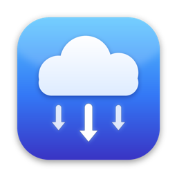

  

<h1 align="center">Downpour</h1>

<b>A fast download manager for Mac: like IDM, made for macOS.</b>

<a href="../../releases/latest"><b>⬇︎ Download the latest version</b></a> · macOS 13 or later · Free beta

---

## Why Downpour?
- **Much faster downloads.** Each file is split into parts that download at the same time, and when one part finishes early, the biggest remaining part is split again, so every connection keeps working until the end.
- **Pause and resume anytime**, even after restarting your Mac. Broken connections retry automatically.
- **Scheduler queues.** Drag downloads into a queue, set the order and a start time, and let your Mac sleep when it's done.
- **Browser extension** for Chrome, Edge, Brave and Arc: downloads go straight to Downpour, and you can grab every link on a page.
- **Video downloads** from thousands of sites.
- **Tidy downloads.** Files are sorted into folders by type, with categories you control.
- **Safe and verified.** Downloaded apps get the same macOS security check as in Safari, and you can paste a checksum to confirm a file is intact.
- **Set it and walk away.** Your Mac stays awake while files download, and the Dock icon shows the current speed.
- **Speed control.** Limit speed, limit it only during certain hours, or share it fairly between downloads.

## 🧪 Free beta: join the early-adopter list for 80% off
Every feature is unlocked for everyone during the beta.

Want **80% off Downpour Pro** when it officially launches? Join the early-adopter list:
1. Open Downpour. The welcome window has a **Join** box (you can also find it any time in **Downpour › Settings… › General**).
2. Enter your email and click **Join**.
3. When Downpour Pro launches, enter **the same email** in the app to claim your discount. We'll also email you when it's ready.

Your email is only used for launch news and your discount. See the [privacy policy](PRIVACY.md).

## 🗺️ Roadmap
Downpour is a work in progress, and new features arrive through automatic updates. Coming next: automatic archive extraction, audio-only and subtitle video downloads, virus scanning, and later BitTorrent, remote control from your phone and translations.

See everything that's available now and what's planned in the **[roadmap](ROADMAP.md)**.

## Free and Pro
After the beta, Downpour stays **free** for everyday downloading. **Downpour Pro** adds the power features:

| | Free | Pro |
|---|:---:|:---:|
| Fast multi-part downloads | up to 4 parts | up to 32 parts |
| Pause, resume, auto-retry | ✓ | ✓ |
| Browser extension & categories | ✓ | ✓ |
| Video downloads from thousands of sites | | ✓ |
| Scheduler queues (start/stop times, sleep when done) | | ✓ |
| Speed limits, timed limits, fair sharing, priorities | | ✓ |
| Grab every link on a web page | | ✓ |

- **Try Pro free for 7 days** — no payment or account needed. When the trial ends, Pro features lock again; your downloads and settings stay.
- **Pro is a one-time purchase of $15**, yours to keep. Early adopters pay **$3**.

## Installing
1. Download **Downpour-x.x.x.dmg** from the [latest release](../../releases/latest).
2. Open it and drag **Downpour** into **Applications**.

### Opening Downpour the first time
Downpour isn't sold through the App Store, so macOS asks you to confirm the first time:
1. Open Downpour. macOS says it can't verify the developer. Click **Done**.
2. Open **System Settings › Privacy & Security**.
3. Scroll down and click **Open Anyway** next to Downpour, then confirm.

You only need to do this once. After that, Downpour opens normally and updates itself.

## Installing the browser extension
The extension sends your browser downloads straight to Downpour, adds **Download with Downpour** to the right-click menu, and lets you grab every link on a page. It works in **Chrome, Edge, Brave, Arc, Opera and Vivaldi**.

It isn't in the Chrome Web Store, so it's installed with the browser's **Load unpacked** button. It takes about a minute, and you only do it once.

### Recommended: install it from Downpour
Installed this way, the extension **updates itself** whenever Downpour updates.

1. Open **Downpour**, then **Downpour › Settings… › Browser**.
2. Click **Show Extension Folder**. A Finder window opens with a folder called **ChromeExtension** selected. Leave it open.
3. In your browser, open the extensions page by typing its address into the address bar and pressing Return (or click **Copy "chrome://extensions"** in Downpour's settings and paste it):

   | Browser | Address |
   |---|---|
   | Chrome, Arc | `chrome://extensions` |
   | Edge | `edge://extensions` |
   | Brave | `brave://extensions` |
   | Opera | `opera://extensions` |
   | Vivaldi | `vivaldi://extensions` |

4. Turn on **Developer mode**. In most browsers, it's a switch in the **top-right corner**; in Edge, it's in the **left sidebar**.
5. Click **Load unpacked**, the button that appears at the top left.
6. In the window that opens, go to the **ChromeExtension** folder from step 2, select it, and click **Select**. (Tip: you can drag the folder from Finder onto the window instead.)
7. **Downpour** now appears in your list of extensions.
8. **Pin it** so it's easy to reach: click the puzzle-piece icon 🧩 in the toolbar, then the pin 📌 next to Downpour.

### Alternative: install it from the zip
1. Download **Downpour-Extension-x.x.x.zip** from the [latest release](../../releases/latest).
2. Double-click it to unzip it, and move the **Downpour Extension** folder somewhere it can stay, for example your Documents folder.
3. Follow steps 3–8 above, choosing the **Downpour Extension** folder in step 6.

Installed this way, the extension doesn't update itself: download the new zip after each update and repeat the steps, or switch to the recommended method.

### Check that it works
Click the Downpour icon in your browser's toolbar. It should say **Connected to the Downpour app** in green. Then try right-clicking any download link and choosing **Download with Downpour**.

### Troubleshooting
- **"Downpour app isn't running"**: open the Downpour app. The extension only works while Downpour is open (it can keep running in the menu bar with its window closed).
- **Downloads still go to the browser**: open the extension's popup and make sure **Send browser downloads to Downpour** is ticked. If Downpour isn't running, the browser keeps the download, so nothing gets lost.
- **The extension disappeared or shows an error**: its folder was probably moved or deleted. Install it again with the recommended method.
- **A notice about "developer mode extensions"**: that's normal for extensions installed with Load unpacked. Keep Developer mode turned on, or the extension stops working.
- **A site's downloads should stay in the browser**: open the extension's menu on that site and click **Don't catch downloads on this site**, or list it in **Downpour › Settings… › Browser › Sites to leave alone**.
- **Every download is sent twice**: the extension is installed twice. Open the extensions page and remove one copy.

The extension only talks to the Downpour app on your own Mac. It doesn't send your browsing anywhere else.

## Feedback
Beta feedback decides what comes next.
- **Something broken?** [Report a problem](../../issues/new?template=bug_report.yml) and pick the part of Downpour it's about.
- **Have an idea?** [Suggest a feature](../../issues/new?template=feature_request.yml). Check the [roadmap](ROADMAP.md) first, and 👍 existing ideas you'd like.
- **From the app:** **Help › Report a Problem…** or **Suggest a Feature…** fills in your Downpour and macOS versions for you. You can also right-click a download that failed and choose **Report a Problem with This Download…**

If you enjoy Downpour, a ⭐ on this page helps other Mac users find it.

## Privacy
Downpour has no tracking, analytics or ads. Your downloads, history and settings stay on your Mac. The only thing ever sent to us is an email address you choose to type into the early-adopter box. Details in the [privacy policy](PRIVACY.md).

## Credits
Downpour uses these open-source projects:
- [Sparkle](https://sparkle-project.org) for automatic updates (MIT License).
- [yt-dlp](https://github.com/yt-dlp/yt-dlp) for video downloads (Unlicense, public domain).
- [Deno](https://deno.com) to help yt-dlp with some video sites (MIT License).
- [FFmpeg](https://ffmpeg.org) to join video and audio (GNU GPL); source code at ffmpeg.org.

yt-dlp, Deno and FFmpeg aren't included in Downpour. They're downloaded from their official releases, with your permission, the first time you download a video.

---

Please only download files and videos you have the right to save.

© 2026 Amirhossein Davoudi. All rights reserved. See [LICENSE](LICENSE) and the [security policy](SECURITY.md).
